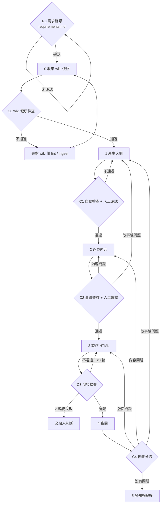

# 流程 B：投影片製作流程（graph 版）— v0.2

> 狀態：**v0.2**。v0.1 做出簡報 v2 後，發現簡報定位和作業要求不符，所以在最前面加上 **R0 需求確認**，並把幾個檢查往前移（見文末「v0.2 修改」）。
> 建 wiki 的流程 A 見 [workflows/wiki-workflow.md](../../workflows/wiki-workflow.md)。
> 目的：把「從 wiki 做投影片」拆成有明確**輸入、輸出、檢查關卡、退回路徑**的流程圖（graph），
> 每一步的產出都存成檔案，可以追溯、可以重跑。

## 流程圖

## 狀態（每個階段的產出檔）

所有中間產出都放在 `slides/pipeline/`，下一階段**只讀上一階段的產出**，不直接跳回去讀 raw/。

| 檔案 | 由哪個階段產生 | 內容 |
|---|---|---|
| `../../requirements.md` | R0 需求 | 作業要求、對應產出、驗收標準 |
| `00-snapshot.md` | 0 收集 | wiki 頁面清單、連結數、統計數字、C0 報告 |
| `01-outline.md` | 1 大綱 | 故事線、每頁標題＋一句重點＋引用頁面 |
| `02-slides-spec.md` | 2 逐頁內容 | 每頁的文字、視覺類型、講稿、來源 |
| `03-deck.html` | 3 製作 | 投影片本體 |
| `04-review.md` | 4 審閱 | 截圖檢查結果、修改清單與分流 |
| `../prompt-engineering-wiki-v2.html` | 5 發佈 | 定版的投影片 |

## 各階段規格

### 關卡 R0：需求確認（v0.2 新增）
- **輸入**：作業說明
- **輸出**：`requirements.md`（已確認）
- **檢查**：每項作業要求都有對應產出與驗收標準；有「還不知道」的項目就**不往下走**，先問人

### 階段 0：收集 wiki 快照
- **輸入**：`wiki/` 全部頁面
- **做什麼**：列出頁面、類型、來源、連結數；計算圖譜（節點／連結）；統計數字
- **輸出**：`00-snapshot.md`
- **C0 wiki 健康檢查（自動）**
  - [ ] 每頁都有 frontmatter
  - [ ] 非來源頁都有 `sources`
  - [ ] 沒有孤兒頁
  - [ ] 每頁都列在 `index.md`
  - [ ] 斷掉的連結只能是「規劃中」的主題
  - [ ] 快照裡的數字（分類頁數加總）和實際一致（v0.2 新增）
  - 改用 `scripts/check_wiki.py` 執行，檢查的定義固定在程式裡（v0.2）
  - 不通過 → 先回 wiki 做 lint／ingest，**不要在簡報裡繞過 wiki 的問題**

### 階段 1：產生大綱
- **輸入**：`00-snapshot.md`、已確認的 `requirements.md`
- **做什麼**：決定故事線與段落，每頁只寫：標題、**一句話重點**、引用的 wiki 頁面；寫的時候就遵守 C2 的字數上限（v0.2）
- **輸出**：`01-outline.md`
- **C1 自動檢查**
  - [ ] 每頁都有一句話重點（只能一個重點）
  - [ ] 每頁至少引用 1 個 wiki 頁面；方法說明頁可以引用 `CLAUDE.md`
  - [ ] 頁數符合時間（約每頁 1 分鐘）
  - [ ] 段落順序：問題 → 方法 → 成果 → 反思
  - [ ] 作業要求的項目都有對應頁面（**必須是 ✅，不能是「不知道」**，v0.2）
  - [ ] 快照版本是最新的；大綱完成後如果又 ingest，大綱標成過期（v0.2）
- **C1 人工確認（你）**：故事線、頁數、要不要加或刪哪些頁
  - 不通過 → 依意見修改大綱，版本號 +0.1，再跑 C1

### 階段 2：逐頁內容
- **輸入**：已確認的 `01-outline.md`＋它引用的 wiki 頁面
- **做什麼**：每頁寫出——標題、內文（條列／表格／程式碼）、**視覺類型**（流程圖／圖表／比較表／時間軸／圖譜）、講稿（講者要說的話）、來源
- **輸出**：`02-slides-spec.md`
- **C2 事實查核（自動）**
  - [ ] 每個數字、引述都能在引用的 wiki 頁面找到，而且數值一致
  - [ ] wiki 標成「（推論）」的內容，在投影片上也要標成推論
  - [ ] 文字量：每頁條列 ≤ 5 點、每點 ≤ 30 字
  - [ ] 專有名詞與 wiki 一致（中英對照）
- **C2 人工確認（你）**
  - 內容問題 → 回到階段 2；故事線問題 → 回到階段 1

### 階段 3：製作 HTML
- **輸入**：已確認的 `02-slides-spec.md`
- **做什麼**：套用固定版型，依「視覺類型」產生圖表或圖譜；**不新增 spec 裡沒有的內容**
- **輸出**：`03-deck.html`
- **C3 渲染檢查（自動，在瀏覽器裡跑）**
  - [ ] 每頁沒有文字溢出、元素沒有被切掉
  - [ ] 圖表標籤沒有互相重疊
  - [ ] 主控台沒有錯誤
  - [ ] 深色、淺色模式都看得清楚
  - [ ] 換頁、全螢幕、手機滑動都正常
  - [ ] 投影片文字和 spec 一致（逐頁比對）
  - 不通過 → 自動修正再檢查，**最多 3 輪**；3 輪仍失敗就交給人判斷

### 階段 4：審閱
- **輸入**：`03-deck.html`
- **做什麼**：AI 逐頁截圖目視檢查，再給你看
- **輸出**：`04-review.md`（問題清單）
- **C4 修改分流**：每個問題標上類型，決定退回哪裡
  - 版面問題（字太小、對齊、顏色）→ 階段 3
  - 內容問題（說法、數字、講稿）→ 階段 2
  - 故事線問題（順序、增刪頁面）→ 階段 1
  - 沒有問題 → 階段 5

### 階段 5：發佈與紀錄
- 複製成定版檔 `slides/prompt-engineering-wiki-v2.html`（v1 保留不刪）
- 在 `wiki/log.md` 追加一筆 `export` 紀錄，更新 `README.md` 的簡報連結

## 全域規則
1. **單向依賴**：每個階段只讀上一階段已確認的產出。
2. **人工關卡不能跳過**：R0、C1、C2、C4 沒有你的確認，不往下走。使用者明確說「直接做」時可以跳過，但要在產出檔記錄「由使用者指示跳過」。
3. **退回要留紀錄**：每次退回都在該產出檔最上面記「版本、退回原因、修改了什麼」。
4. **自動修正有上限**：C3 最多 3 輪，避免無限迴圈。

## v0.2 修改（依簡報 v2 的實際執行結果）
| 問題（實際發生） | 在哪個節點發現 | 檢查往前移到 |
|---|---|---|
| 簡報定位和作業要求不符（講流程本身，而不是交作業） | C4 之後，使用者看完 v2 才發現 | **R0 需求確認**；C1「作業要求」項目不能是「不知道」 |
| 快照頁面分類計數錯誤（概念 7，實際 6） | 階段 3 寫圖譜程式時 | **C0** 加入「數字加總一致」，改用程式檢查 |
| 大綱寫完後又 ingest，大綱過期 | 階段 1 之後 | **C1** 檢查快照版本 |
| 5 頁條列超過字數 | C2 | **階段 1** 寫大綱時就遵守字數上限 |
