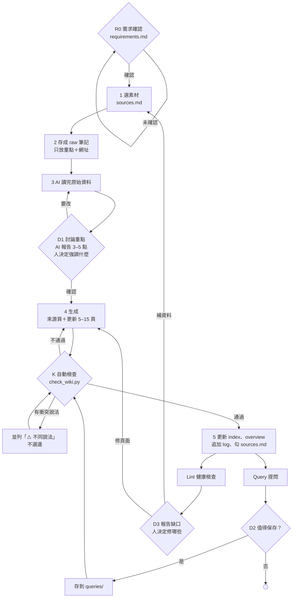

# 流程 A：建 wiki（ingest → query → lint）

> 把「建一份 Prompt Engineering wiki」拆成 AI 能做的節點，每個生成節點前都有**人工討論（D）**，生成後有**自動檢查（K）**。
> 規則本體在 [CLAUDE.md](../CLAUDE.md)；需求在 [requirements.md](../requirements.md)；做簡報的流程 B 見 [slides/pipeline/README.md](../slides/pipeline/README.md)。

## 流程圖

## 節點說明
| 節點 | 誰做 | 輸入 → 輸出 | 檢查 |
|---|---|---|---|
| **R0 需求確認** | 人 | 作業說明 → `requirements.md` | 作業要求都有對應產出與驗收標準，沒確認不往下走 |
| 1 選素材 | 人＋AI | 主題 → `sources.md` 清單 | 官方指南、論文、文章都要有 |
| 2 存 raw 筆記 | AI | 網頁／論文 → `raw/` | 只放自己整理的重點＋網址（著作權）；AI 之後不再修改 |
| 3 讀原始資料 | AI | `raw/` | 讀完整份，不只讀標題 |
| **D1 討論重點** | 人 | AI 報告 3–5 點 → 人選強調哪些 | 對照 `requirements.md`：和主題、作業有關的優先 |
| 4 生成 | AI | 討論結果 → `wiki/` 頁面 | 只寫來源裡有的；沒來源支持的推論標「（推論）」 |
| **K 自動檢查** | 程式 | `wiki/` → 檢查報告 | frontmatter、sources、每頁連出 ≥ 2、無孤兒頁、斷連結只能是規劃主題、每頁在 index、**頁數加總一致** |
| 衝突處理 | AI | 不同來源說法不同 | 照 CLAUDE.md 2.5，並列「⚠️ 不同說法」，不自己選邊 |
| 5 收尾 | AI | → index、overview、log、sources.md | log 只往下追加 |
| **D2 保存問答** | 人 | 好答案 → `queries/` | 存回去後重跑 K |
| **D3 Lint 報告** | 人 | 缺口清單 → 決定補資料或修頁面 | 先報告、經同意再修 |

## 實際執行紀錄
- [reports/ingest-run-2026-11-10.md](../reports/ingest-run-2026-11-10.md)：補討論第二批 5 份資料，K 檢查第 1 輪抓到 1 個孤兒頁，第 2 輪通過。
